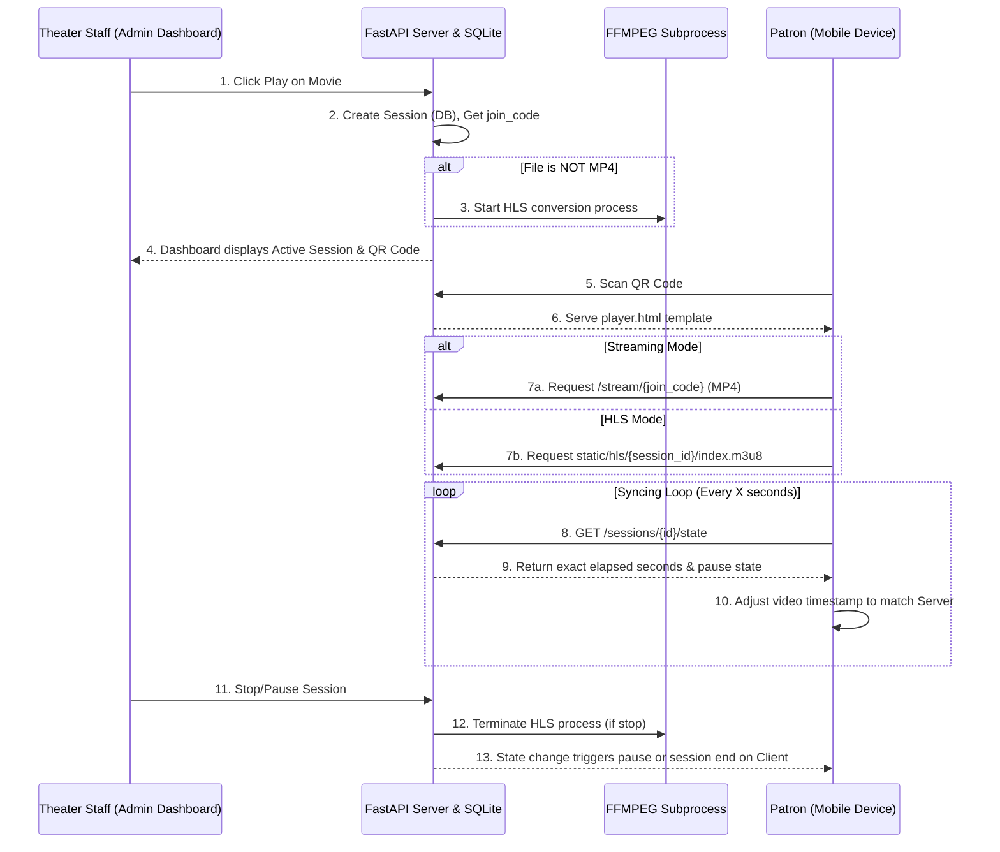

# Project Structure and Outline: Cinematic Break Pilot System

## 1. Project Scope & Goals
**Cinematic Break** is a secure, low-latency media streaming service designed for movie theaters. 

**Goals:**
- Provide a system running as a Dockerized server on a mini-PC within a theater's local network.
- Allow patrons to seamlessly sync the ongoing movie to their personal devices (smartphones, tablets) by scanning a QR code, so they don't miss a beat if they have to leave the auditorium.
- Offer theater staff a simple Admin Dashboard to start, stop, and pause movie sessions.
- Support both native MP4 streaming and on-the-fly HTTP Live Streaming (HLS) generation for broader compatibility.

---

## 2. Project Structure

The project relies on a standard FastAPI architecture integrated with SQLite and Jinja2 templates.

```text
cinematicbreak/
├── app/
│   ├── main.py             # Core FastAPI application (routing, streaming, process management)
│   ├── database.py         # SQLite database initialization and connection handling
│   ├── static/             # Static assets and temporarily generated HLS video segments
│   └── templates/          # Jinja2 HTML templates (Admin UI, Client Player, QR pages)
├── config/                 # Reserved for configuration files/expansion
├── media/                  # Video files to be streamed (recursively scanned)
├── web/                    # Reserved for front-end logic or external assets
├── cinematicbreak.db       # SQLite database (auto-generated)
├── Dockerfile              # Docker image definition
├── docker-compose.yml      # Multi-container docker orchestration
└── README.md               # Documentation and setup guide
```

---

## 3. Data & Database Schema
The application uses a lightweight SQLite database (`cinematicbreak.db`) to manage states.

**Table: `sessions`** (Manages active movie streams)
- `id` (INTEGER): Unique identifier for the session.
- `join_code` (TEXT): 8-digit unique code for patrons to join the stream.
- `session_name` (TEXT): Optional name for the session.
- `theater_number` (TEXT): The auditorium/theater identifier.
- `movie_title` (TEXT): Title of the movie being streamed.
- `duration_seconds` (INTEGER): Total length of the media file.
- `start_time` (TIMESTAMP): When the session was initiated.
- `is_paused` (INTEGER): Boolean flag indicating if the session is currently paused.
- `accumulated_seconds` (INTEGER): Seconds elapsed before the latest pause.
- `last_updated_time` (TIMESTAMP): Time of the last state change (play/pause).

**Table: `settings`** (Configuration options)
- `key` (TEXT): e.g., `external_dns`
- `value` (TEXT): Setting value, used for custom base URLs for QR codes.

---

## 4. Key Functions and Endpoints

Located within `app/main.py`, these functions drive the backend logic:

- **`get_video_duration(file_path)`**: Uses a subprocess call to `ffprobe` to determine the exact length of the video file for accurate session expiry.
- **`cleanup_session_hls(session_id)`**: Manages resource cleanup. It kills any active `ffmpeg` processes for the session and deletes temporary HLS video chunks from the `static/hls/` directory.
- **`create_session` (`POST /sessions`)**: Initiates a new movie session. It maps a movie title to a file, calculates duration, generates a join code, saves to the DB, and if the video isn't `.mp4`, spawns an asynchronous `ffmpeg` process to create HLS streams.
- **`stream_media` (`GET /stream/{join_code}`)**: A custom streaming generator that supports byte-range requests. This allows clients to seek through MP4 files and play them natively in the browser without downloading the entire file.
- **`get_session_state` (`GET /sessions/{session_id}/state`)**: Crucial for client-syncing. Returns the exact number of elapsed seconds (accounting for pauses) and the current pause state, allowing the client player to fast-forward/sync to the correct timestamp.
- **`get_session_qr` (`GET /sessions/{session_id}/qr`)**: Generates and serves a QR code image bridging the patron to the `view_player` URL.

---

## 5. Architectural Flow & Communication

The system communicates between the Server (Host PC) and the Client (Patron Device) via the theater's local Wi-Fi.

### Flow Diagram



### How it all works together
1. **Initiation**: The system scans the `media` folder. The admin initiates a stream from the dashboard. The server registers this in SQLite.
2. **Media Processing**: If the media format is natively compatible (like `mp4`), it is streamed directly via range requests. If it's a different format, `ffmpeg` is spun up in the background to transcode the video into HLS (`.m3u8` and `.ts` files) stored in the `static` directory.
3. **Synchronization Mechanism**: True synchronization isn't just about streaming a live feed. Instead, the patron's device streams the file from the beginning, but uses a polling loop (via `/sessions/{id}/state`) to ask the server "Exactly how many seconds into the movie are we?" The client's javascript then seeks the HTML5 video player to that exact second. If the admin pauses the movie, the server stops counting `elapsed_seconds`, and the client automatically pauses.
4. **Cleanup**: Expired sessions (where elapsed time > duration) are automatically cleaned up the next time the admin dashboard is loaded, freeing disk space and CPU resources.
